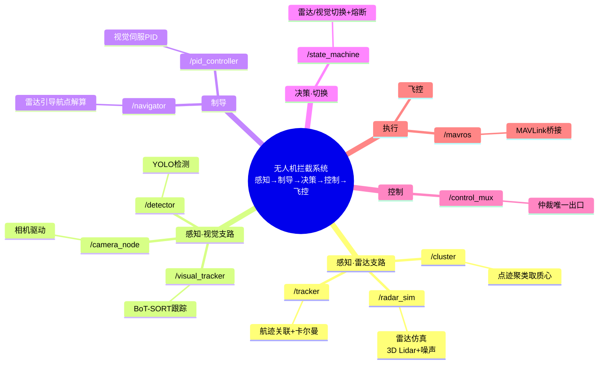
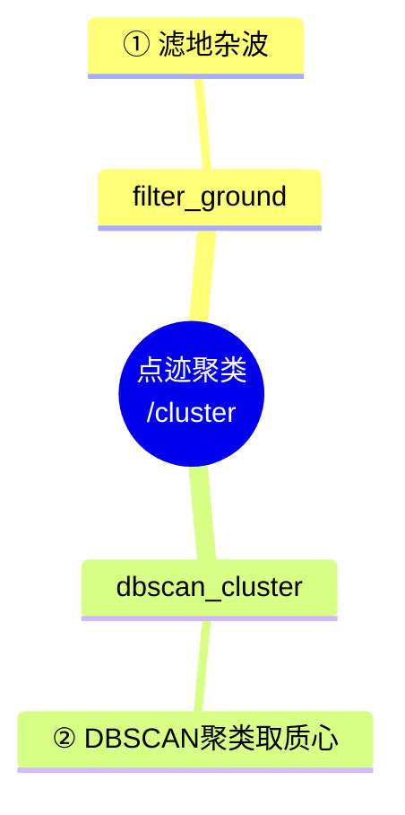
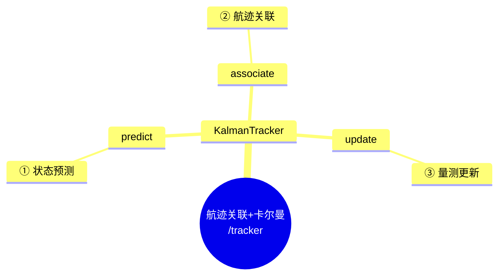
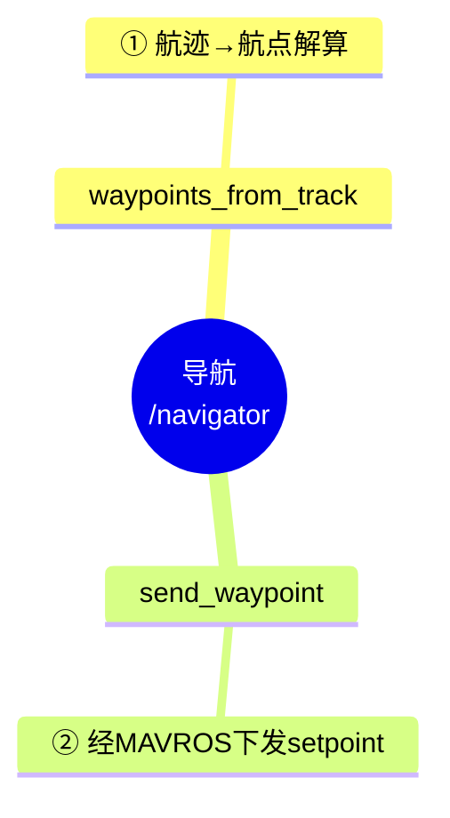
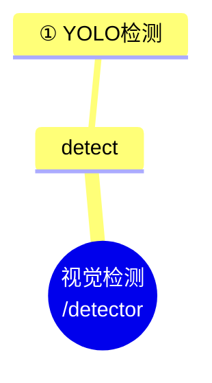
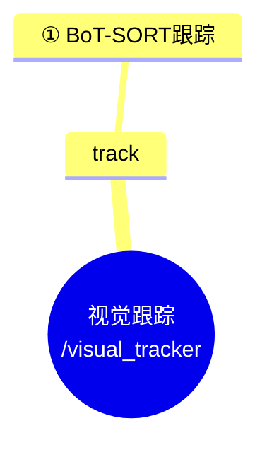
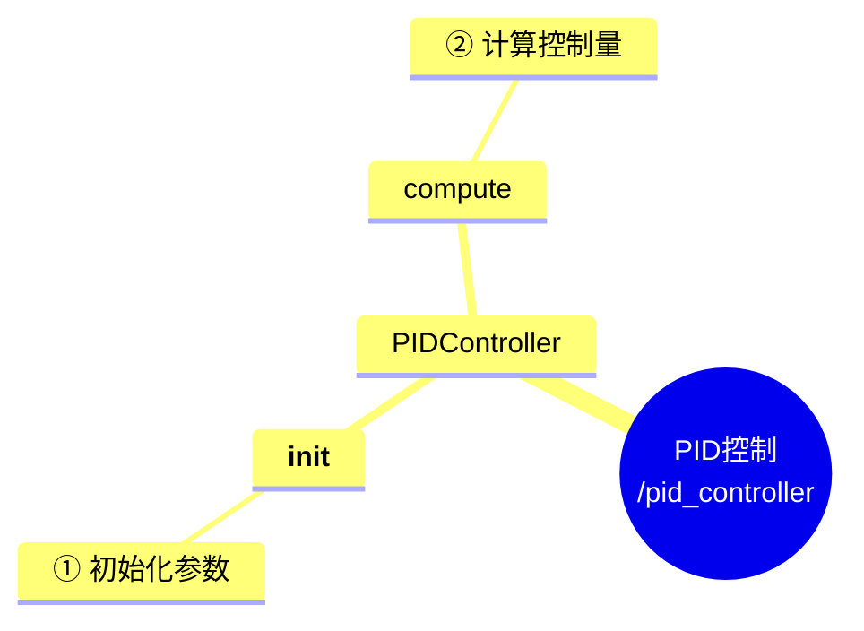
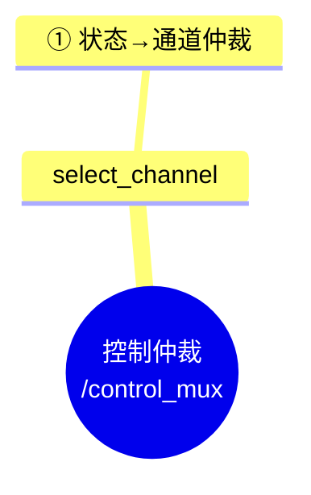
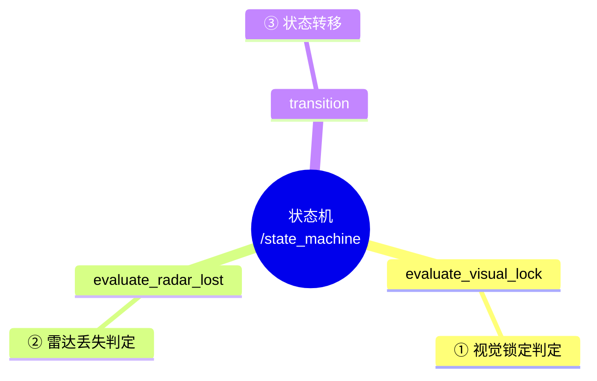

# 函数接口调用关系图

> 依据《无人机项目实施拆解文档》绘制，使用 Mermaid mindmap。
> 说明：
> - 模块间通过 ROS 话题通信（非直接函数调用），故「模块间关系图」体现的是接口（话题）串接关系。
> - 颜色通过 `classDef` 定义并绑定节点，需渲染器支持 Mermaid mindmap 的 class 样式；若颜色未显示，结构关系仍完整有效。

---

## 一、模块间接口关系图（全局）



---

## 二、各模块内部函数调用关系图

### 模块 1：点迹聚类（`/cluster`）



### 模块 2：航迹关联 + 卡尔曼滤波（`/tracker`）



### 模块 3：导航（`/navigator`）



### 模块 4：视觉检测（`/detector`）



### 模块 5：视觉跟踪（`/visual_tracker`）



### 模块 6：PID 控制（`/pid_controller`）



### 模块 7：控制仲裁（`/control_mux`）



### 模块 8：状态机（`/state_machine`）



---

## 三、全部函数接口总图（按模块着色）

```mermaid
mindmap
  root((全部函数接口))
    点迹聚类:::c1
      filter_ground:::c1
      dbscan_cluster:::c1
    航迹关联+卡尔曼:::c2
      associate:::c2
      predict:::c2
      update:::c2
    导航:::c3
      waypoints_from_track:::c3
      send_waypoint:::c3
    视觉检测:::c4
      detect:::c4
    视觉跟踪:::c5
      track:::c5
    PID控制:::c6
      __init__:::c6
      compute:::c6
    控制仲裁:::c7
      select_channel:::c7
    状态机:::c8
      evaluate_visual_lock:::c8
      evaluate_radar_lost:::c8
      transition:::c8
  classDef c1 fill:#e3f2fd,stroke:#1565c0,color:#0d47a1
  classDef c2 fill:#e8f5e9,stroke:#2e7d32,color:#1b5e20
  classDef c3 fill:#fff3e0,stroke:#ef6c00,color:#e65100
  classDef c4 fill:#f3e5f5,stroke:#7b1fa2,color:#4a148c
  classDef c5 fill:#fce4ec,stroke:#c2185b,color:#880e4f
  classDef c6 fill:#e0f7fa,stroke:#00838f,color:#006064
  classDef c7 fill:#ffebee,stroke:#c62828,color:#b71c1c
  classDef c8 fill:#fff8e1,stroke:#f9a825,color:#f57f17
```

### 模块着色对照表

| 颜色类 | 模块 | 填充色 | 描边色 |
|---|---|---|---|
| `c1` | 点迹聚类 | `#e3f2fd` | `#1565c0` |
| `c2` | 航迹关联+卡尔曼 | `#e8f5e9` | `#2e7d32` |
| `c3` | 导航 | `#fff3e0` | `#ef6c00` |
| `c4` | 视觉检测 | `#f3e5f5` | `#7b1fa2` |
| `c5` | 视觉跟踪 | `#fce4ec` | `#c2185b` |
| `c6` | PID 控制 | `#e0f7fa` | `#00838f` |
| `c7` | 控制仲裁 | `#ffebee` | `#c62828` |
| `c8` | 状态机 | `#fff8e1` | `#f9a825` |
